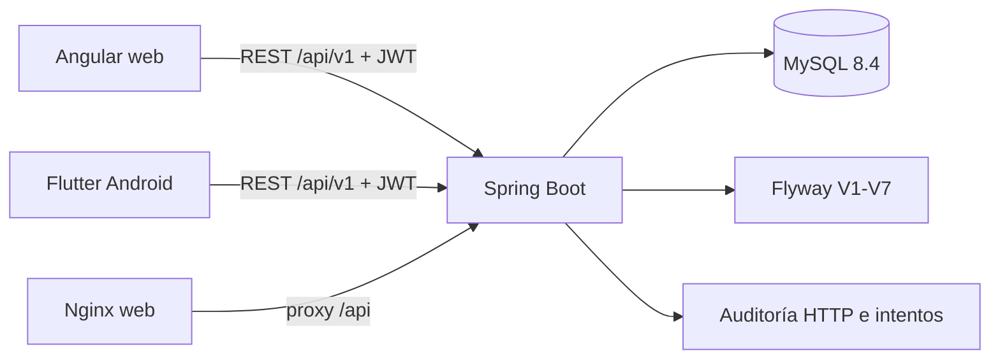
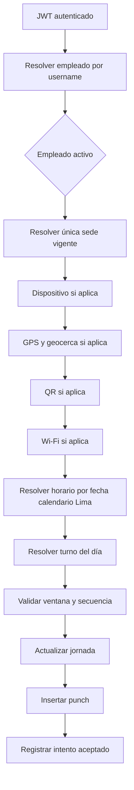

# Auditoría integral del sistema de asistencia

**Fecha de auditoría:** 2026-10-15  
**Zona de negocio:** `America/Lima`  
**Alcance:** Angular, Flutter Android, Spring Boot, MySQL/Flyway, Docker Compose, seguridad, contratos y pruebas.  
**Regla aplicada:** durante esta fase no se modificó código funcional. Este archivo es el único artefacto creado.

## 1. Resumen ejecutivo

El repositorio contiene una base funcional real, no solamente pantallas: autenticación JWT, tres roles, catálogos, empleados, asignaciones con vigencia, horarios, marcación, geocerca, registro de dispositivo, QR temporal, BSSID, solicitudes, incidencias, reportes, auditoría HTTP, Angular responsive, cliente Flutter Android y migraciones Flyway.

Sin embargo, el sistema **todavía no está listo para certificarse como flujo empresarial completo**. El camino feliz básico existe, pero quedan vacíos críticos entre las capas. Los principales son:

1. Las solicitudes aprobadas no producen ningún cambio en asistencia. Una justificación no convierte `ABSENT` en `EXCUSED` y una corrección no crea/corrige marcaciones ni recalcula la jornada.
2. Los turnos nocturnos no se resuelven correctamente después de medianoche porque la jornada siempre se busca con la fecha calendario actual.
3. No hay protección suficiente ante dos marcaciones concurrentes. La restricción de jornada evita algunas duplicaciones, pero puede terminar en error 500 y `punches` no impide dos eventos del mismo tipo.
4. Las ausencias dependen de un endpoint manual y pueden procesarse antes de cerrar realmente la ventana de un turno nocturno.
5. La autorización del supervisor no tiene alcance organizacional: puede consultar o resolver información de todos los empleados.
6. Los CRUD web son principalmente listado + alta. Faltan edición, activación/desactivación y mantenimiento de asignaciones/horarios desde la interfaz.
7. La pantalla de marcación no carga antes de actuar la sede, política, turno ni estado de la jornada, y no presenta el resultado detallado requerido.
8. El reporte actual es un agregado mínimo y no cubre días laborales, asistidos, justificados ni filtros por empleado/sede/área.
9. La auditoría de intentos carece de tipo de acción y sede; las correcciones no tienen registro antes/después. La marcación aceptada guarda el identificador de dispositivo en claro en `punches`.
10. Las 21 pruebas backend, 3 pruebas Angular y 1 prueba Flutter existentes pasan, pero no cubren la mayoría de los escenarios de negocio exigidos.

**Diagnóstico:** base técnica aprovechable, con deuda funcional P0/P1 en asistencia, consistencia temporal, concurrencia, solicitudes y trazabilidad. No se recomienda reescribir el sistema; sí reforzar el dominio y los contratos antes de ampliar la UI.

## 2. Evidencia y método

Se inspeccionaron:

- estructura completa del repositorio;
- 60 archivos Java de producción, controladores, servicios, entidades y repositorios;
- migraciones `V1` a `V7`;
- configuración Spring, seguridad, Docker y Nginx;
- rutas, servicios y páginas Angular;
- cliente HTTP, autenticación, GPS, QR, dispositivo y Wi-Fi en Flutter;
- documentación y colección Postman;
- pruebas automatizadas y scripts de integración.

Validaciones ejecutadas durante la auditoría:

| Comprobación | Resultado |
|---|---|
| `backend/mvnw.cmd test` mediante `tests/run-all.ps1` | 21 pruebas backend, PASS |
| Build Angular | PASS con 2 warnings: presupuesto SCSS del shell y dependencia CommonJS `qrcode` |
| Tests Angular | 3 pruebas en 2 archivos, PASS |
| `flutter analyze` | PASS, sin incidencias; 155,2 s |
| `flutter test --no-pub` | 1 prueba, PASS |
| `docker compose config --services` | PASS: `mysql`, `api`, `web` |
| `docker compose ps` | NO EJECUTABLE: motor Docker Desktop no disponible |
| Flujo HTTPS/API real | No repetido en esta fase porque Docker no estaba disponible |

La prueba `tests/live-security-flow.ps1` contiene 26 verificaciones contra una instalación real, pero su resultado anterior no sustituye una nueva ejecución ni cubre entrada aceptada, salida aceptada, concurrencia o efectos de solicitudes.

Comandos ejecutados:

```powershell
powershell -ExecutionPolicy Bypass -File tests\run-all.ps1
flutter.bat test --no-pub
docker compose ps
docker compose config --services
```

La ejecución agregada fue interrumpida justo después de que `flutter analyze` comunicó `No issues found`, por lo que `flutter test --no-pub` se ejecutó inmediatamente por separado y terminó correctamente. No se presenta la ejecución agregada como PASS atómico; sí se presentan los resultados individuales observados.

## 3. Arquitectura encontrada



### Componentes

| Capa | Implementación encontrada | Evaluación |
|---|---|---|
| Web | Angular 21 standalone, guards, interceptor JWT, temas, diseño responsive | Funcional, cobertura UI parcial |
| Móvil | Flutter Android, almacenamiento seguro, cámara QR, GPS, BSSID, device ID | Funcional básico, casi sin pruebas |
| API | Java 21 objetivo, Spring Boot 3.5, Spring Security, JPA/JdbcClient | Base sólida, dominio incompleto |
| Datos | MySQL 8.4, Flyway, 7 migraciones | Esquema coherente inicial, constraints insuficientes |
| Ejecución | Compose con MySQL/API/web y healthcheck de MySQL | Definido; Docker no estaba activo |
| HTTPS de piloto | Nginx sirve HTTP interno; HTTPS depende de infraestructura externa/Tailscale | Válido para piloto privado, no despliegue final |

### Módulos backend

- `security`: usuarios, roles, login, JWT y bootstrap de administrador.
- `organization`: sedes, áreas, cargos y políticas por sede.
- `employee`: empleados, perfil y asignación organizacional.
- `schedule`: horarios, turnos semanales y asignación con vigencia.
- `attendance`: jornada, marcación, reglas horarias y ausencias manuales.
- `attendance.security`: dispositivos, geocerca, QR, Wi-Fi e intentos.
- `request`: solicitudes e incidencias.
- `report`: resumen agregado.
- `audit`: auditoría HTTP persistente.

## 4. Flujo actual reconstruido

### Preparación

El administrador puede crear usuario, empleado, sede, área, cargo y horario; luego crea una asignación organizacional y una asignación de horario. Puede configurar cuatro controles por sede y aprobar dispositivos.

Limitaciones actuales:

- la UI no guía el proceso como un asistente ni comprueba qué paso falta;
- las asignaciones solo se crean; no hay operación normal para cerrarlas, corregirlas o desactivarlas;
- el formulario genérico deja visible “Nuevo registro” al supervisor en recursos donde el backend solo permite alta a `ADMIN`;
- el horario web crea automáticamente lunes a viernes con las mismas horas; no permite configurar días distintos o un turno nocturno de forma explícita;
- no se valida que las entidades asignadas estén activas ni que las fechas sean coherentes con alta/baja del empleado.

### Entrada/salida actual



Aspectos correctos:

- el empleado se obtiene del usuario autenticado, no de un `employeeId` enviado por el cliente;
- la hora de la marcación viene de `Instant.now()` del servidor;
- las políticas se aplican por sede y solo si están activas;
- geocerca se calcula en backend con Haversine;
- QR se genera con `SecureRandom`, solo se persiste su SHA-256 y un QR nuevo invalida el anterior;
- entrada/salida duplicada se valida secuencialmente;
- los rechazos funcionales se almacenan en `punch_attempts` mediante transacción independiente.

Aspectos incompletos o incorrectos:

- el backend usa la fecha calendario actual antes de considerar que una salida a la 01:00 puede pertenecer al turno de las 22:00 del día anterior;
- no existe endpoint de “contexto de hoy” para que el cliente conozca sede, controles requeridos, turno y jornada antes de pedir sensores;
- Angular y Flutter solicitan GPS/device ID/BSSID aun cuando la política podría no requerirlos;
- la respuesta se ignora en ambas UI y solo se muestra “Entrada registrada” o “Salida registrada”;
- Angular recarga historial después de marcar, pero no representa un estado operativo claro de “sin entrada / jornada abierta / completada”;
- no se distingue QR ausente, inválido, vencido o perteneciente a otra sede: todo termina como `INVALID_QR`;
- no se distingue Wi-Fi ausente de Wi-Fi incorrecto;
- el `channel` lo controla libremente el cliente y no existe whitelist;
- no se valida rango de latitud/longitud en DTO ni BD;
- el BSSID y el identificador enviados no están normalizados antes de persistirse en `punches`.

## 5. Matriz de permisos observada

| Capacidad | ADMIN | SUPERVISOR | EMPLOYEE | Observación |
|---|---:|---:|---:|---|
| Usuarios | Sí | No | No | Backend protegido correctamente |
| Empleados: consultar | Sí | Sí | No | Supervisor ve todos, sin alcance |
| Empleados: crear/editar | Sí | No | No | UI genérica puede ofrecer alta al supervisor, API la rechaza |
| Organización | Sí | No | No | Correcto por rol |
| Horarios: consultar | Sí | Sí | Propio | Correcto en términos generales |
| Horarios: crear/asignar | Sí | No | No | Correcto en backend |
| Solicitudes propias | Si tiene empleado vinculado | Si tiene empleado vinculado | Sí | Las rutas personales dependen del vínculo, no del rol |
| Revisar solicitudes | Sí | Sí | No | Sin alcance de supervisión |
| Incidencias propias | Si tiene empleado vinculado | Si tiene empleado vinculado | Sí | Ownership resuelto por autenticación |
| Gestionar incidencias | Sí | Sí | No | Sin alcance de supervisión |
| Políticas/QR/dispositivos | Sí | No | Solo solicitar su dispositivo | Correcto por rol |
| Reportes | Sí | Sí | No | Supervisor ve toda la organización |
| Auditoría | Sí | No | No | Correcto por rol |

### Riesgo de autorización

No existe modelo de empleados “a cargo” de un supervisor. Por ello, el rol `SUPERVISOR` tiene acceso horizontal a empleados, solicitudes, incidencias y reportes de toda la empresa. No es un IDOR de empleado autenticado, pero sí una carencia de autorización por alcance organizacional.

Además, desactivar un usuario no revoca un JWT ya emitido; será utilizable hasta su expiración (15 minutos). El empleado inactivo sí se comprueba al marcar.

## 6. Inventario funcional

| Funcionalidad | Angular | Flutter | Backend | BD | Prueba actual | Estado auditado |
|---|---|---|---|---|---|---|
| Login JWT | Sí | Sí | Sí | Sí | Backend + unit web básica | PARCIAL |
| Roles/guards | Sí | Implícito | Sí | Sí | Anónimo y algunos roles vía script | PARCIAL |
| Usuarios | Alta/listado | N/A | Alta/listado/estado/password | Sí | No específica | PARCIAL |
| Empleados | Alta/listado/foto | Perfil propio | Alta/listado/edición | Sí | No | PARCIAL |
| Sedes/áreas/cargos | Alta/listado | N/A | Alta/listado/edición | Sí | No | PARCIAL |
| Asignación organizacional | Alta | N/A | Alta/listado | Sí | No | PARCIAL |
| Horarios/turnos | Alta simplificada/listado | Consulta propia | Alta/listado/asignación | Sí | Reglas diurnas unitarias | PARCIAL |
| Política por sede | Sí | Consume indirectamente | Sí | Sí | API viva parcial | PARCIAL |
| Dispositivo | Solicitud/aprobación admin | Solicitud | Sí | Hash y unique | API viva parcial | PARCIAL |
| Geocerca | Captura GPS | Captura GPS | Haversine | Coordenadas | Unit + API simulada | PARCIAL |
| QR generado | QR gráfico | N/A | Token seguro/hash/expiración | Sí | API viva parcial | PARCIAL |
| QR scanner | Web HTTPS | Android | Recibe token | N/A | Sin prueba de cámara | PENDIENTE HARDWARE |
| Wi-Fi/BSSID | No disponible y envía null | Lectura Android | Normaliza/compara | Sí | Unit + API simulada | PARCIAL |
| Entrada | Sí | Sí | Sí | Sí | Ventana unitaria; no E2E aceptado fresco | PARCIAL |
| Salida | Sí | Sí | Sí | Sí | Ventana unitaria | PARCIAL |
| Turno nocturno | UI puede expresar horas | Muestra horario | Modelo parcial | Sí | Ninguna | INCOMPLETO |
| Doble marcación concurrente | Botón se bloquea | Botón se bloquea | Sin lock/idempotencia | Constraint insuficiente | Ninguna | INCOMPLETO |
| Ausencia automática | No | No | Solo endpoint manual | Jornada unique | Ninguna | INCOMPLETO |
| Solicitudes | Alta mínima/listado/revisión | Alta mínima/listado | Estado de revisión | Sí | Revisión de estado | PARCIAL |
| Efecto de justificación | No | No | No | Enum `EXCUSED` sin transición | No | INCOMPLETO |
| Efecto de corrección | No | No | No | Referencias sin usar | No | INCOMPLETO |
| Permiso temporal | No fechas en UI | No fechas en UI | Campos opcionales | Sí | No | INCOMPLETO |
| Incidencias | Manual/listado | Consulta propia indirecta | Manual/cierre | Sí | No | PARCIAL |
| Incidencias automáticas | No | No | No | Posible relación a jornada | No | INCOMPLETO |
| Reportes | Tabla genérica | No | Resumen mínimo | Consulta real | No | PARCIAL |
| Auditoría HTTP | Consulta admin | N/A | Mutaciones HTTP | Sí | Arranque indirecto | PARCIAL |
| Auditoría de negocio | Intentos | N/A | Intentos aceptados/rechazados | Sí | API viva parcial | PARCIAL |

## 7. Hallazgos priorizados

### P0 — bloquean la demostración funcional principal

#### A-001. Aprobar solicitudes no tiene efecto real

`EmployeeRequestController.review` únicamente cambia estado, revisor, comentario y fecha. No invoca un servicio de asistencia. Las columnas `incident_id`, `attendance_day_id` y `punch_id` existen en la migración, pero no están mapeadas en la entidad ni se rellenan.

**Impacto:** los escenarios obligatorios de justificación y corrección no pueden completarse. Reportes y jornadas permanecen iguales tras aprobar.

#### A-002. Turnos nocturnos incorrectos después de medianoche

`AttendanceService.punch` calcula `workDate` con la fecha calendario de `Instant.now()` y busca el turno de ese día. No intenta resolver el turno iniciado el día anterior.

**Impacto:** una salida válida de 22:00–06:00 puede producir `NON_WORKING_DAY`, `NO_ACTIVE_SCHEDULE` o `EXIT_WITHOUT_ENTRY`.

#### A-003. Concurrencia no protegida de extremo a extremo

La lógica hace read-validate-save sin lock pesimista/optimista ni clave idempotente. Existe unique de `(employee_id, work_date)` en `attendance_days`, pero no unique para `(attendance_day_id, punch_type)`. Dos requests simultáneos pueden competir: una falla con excepción de integridad no traducida o ambas pueden insertar punches dependiendo del interleaving.

**Impacto:** error 500 o eventos duplicados ante doble clic/reintento/latencia.

#### A-004. Ausencias no automáticas y temporalmente inseguras

`processAbsences(date)` solo exige que `date` sea anterior a hoy. No existe `@Scheduled`, calendario de cierre ni comprobación de fin del turno + ventana de salida.

**Impacto:** operación manual permanente y posible ausencia prematura para turno nocturno.

### P1 — necesarios para una versión empresarial consistente

#### A-005. La UI no obtiene el contexto de marcación

No hay contrato que devuelva sede, turno del día, jornada actual y controles activos. Los clientes intentan sensores sin saber si son requeridos y no pueden construir la experiencia especificada.

#### A-006. Códigos de rechazo demasiado agregados

QR ausente/vencido/otra sede/incorrecto devuelve `INVALID_QR`; Wi-Fi ausente/incorrecto devuelve `WIFI_NOT_ALLOWED`; sede usa nombres diferentes a los requeridos (`NO_ACTIVE_SITE_ASSIGNMENT`, `SITE_ASSIGNMENT_OVERLAP`).

**Impacto:** mensajes poco precisos y pruebas funcionales ambiguas.

#### A-007. Auditoría insuficiente para reconstruir asistencia

`punch_attempts` no guarda `site_id` ni acción entrada/salida. `correlation_id` existe pero el insert no lo establece. El audit HTTP omite todos los GET y no registra before/after. La generación de QR y revisiones quedan como URI/HTTP, no evento de negocio rico. El login se audita sin garantía de asociar el usuario autenticado.

#### A-008. Identificador de dispositivo persistido en claro

Aunque `registered_devices` y `punch_attempts` usan hash, `Punch` asigna el valor original a `device_identifier`.

**Impacto:** inconsistencia de privacidad y trazabilidad.

#### A-009. Supervisor sin alcance

Puede listar y resolver solicitudes, incidentes, empleados y reportes globales. No existe relación supervisor-área/sede/equipo.

#### A-010. CRUD web incompleto y permisos visuales inconsistentes

`ResourcePage` solo invoca GET/POST; `ApiService` ni siquiera implementa PUT/DELETE. El formulario de alta se muestra a `ADMIN` y `SUPERVISOR`, aunque varios POST son solo de administrador.

#### A-011. Asignaciones imposibles de mantener operativamente

La API permite crear/listar asignación organizacional y crear horario, pero no cerrar vigencia, desactivar, corregir ni consultar claramente la asignación activa. Los solapamientos se validan en aplicación, no en BD y son vulnerables a concurrencia.

#### A-012. Reportes incompletos

Solo ofrece `recorded_days`, ausencias y sumas de minutos. Faltan días laborales, asistidos, justificados, conteos de tardanza/salida anticipada y filtros por empleado/sede/área. Incluye jornadas `OPEN` sin tratamiento explícito.

#### A-013. Validación de coordenadas y entradas técnicas insuficiente

Los DTO aceptan cualquier `Double`; no hay límites `[-90,90]` y `[-180,180]`. `channel` también acepta cualquier texto. No existen constraints equivalentes en MySQL.

#### A-014. Usuario desactivado conserva acceso hasta expirar JWT

La actividad se valida al emitir token, no en cada request. Para acciones sensibles se requiere decidir revocación inmediata o aceptar/documentar la ventana máxima de 15 minutos.

#### A-015. Bootstrap administrativo restablece contraseña en cada arranque

Si las variables permanecen definidas, `BootstrapAdminInitializer` vuelve a activar el usuario, agrega `ADMIN` y cambia su contraseña cada vez que inicia la API.

**Impacto:** conveniente en desarrollo, riesgoso en producción y puede revertir una rotación de credenciales.

#### A-016. Confianza directa en `X-Forwarded-For`

La API toma el primer valor del header sin configurar proxies de confianza.

**Impacto:** IP de auditoría falsificable si la API queda accesible directamente.

#### A-017. Android permite HTTP en el manifest principal

`android:usesCleartextTraffic="true"` no está limitado al build debug.

**Impacto:** una compilación release podría transmitir credenciales/JWT por HTTP.

### P2 — calidad, mantenibilidad y UX

#### A-018. Estados sin transiciones implementadas

`EXCUSED`, `UNDER_REVIEW` y `CANCELLED` existen pero no tienen operaciones funcionales completas. `INCOMPLETE` casi no puede producirse por API porque el validador impide salida sin entrada.

#### A-019. Columnas y conceptos sin uso

- `punches.qr_reference` existe pero no se mapea ni rellena.
- `punch_attempts.correlation_id` existe pero no se rellena.
- relaciones de solicitud a incidencia/jornada/punch existen en BD pero no en la entidad.
- `calculation_version` existe pero no se usa para recalcular/versionar.

No deben eliminarse todavía: varios son necesarios para completar el dominio.

#### A-020. Fotos externas sin gestión de archivo

Web renderiza `photoUrl` arbitraria. No existe subida, validación de contenido, proxy ni imagen por defecto gestionada. Es aceptable para piloto, no una solución final de perfiles.

#### A-021. Dependencia de Google Fonts en tiempo de ejecución

Los estilos importan fuentes desde Internet. En red restringida o sin conexión se degrada tipografía y privacidad. Conviene empaquetarlas localmente.

#### A-022. Manejo de expiración de sesión incompleto

El interceptor agrega JWT, pero no existe manejo central de 401 para limpiar sesión y redirigir. Flutter valida expiración al restaurar, pero no intercepta expiración durante uso.

#### A-023. Errores UI demasiado genéricos

Algunas pantallas silencian fallos (`attendance.load`) o reducen todos los errores a un mensaje. Flutter imprime directamente `detail`, que hoy puede ser un código técnico.

#### A-024. Documentación desactualizada

`architecture.md` y `requirements.md` todavía describen decisiones como futuras, mientras `progress.md` declara fases 0–33 completadas. La afirmación “certificadas” excede la evidencia disponible.

## 8. Contratos y consistencia entre capas

### Coincidencias verificadas

- Login usa `username`, `password` y recibe `accessToken` en Angular y Flutter.
- Punch usa `type`, `channel`, `deviceIdentifier`, `latitude`, `longitude`, `qrCode`, `wifiBssid` en ambos clientes y backend.
- Registro de dispositivo coincide en `identifier`, `displayName`, `platform`.
- QR administrativo coincide en `siteId`, `validSeconds`, `code`, `expiresAt`.
- Historial usa los nombres que devuelve `AttendanceService.Result`.

### Divergencias funcionales

- La API soporta fechas, cambio propuesto y evidencia en solicitudes; Angular y Flutter solo envían tipo y motivo.
- El backend devuelve resultado rico de marcación, pero los clientes lo descartan.
- El backend soporta turnos por día; Angular fuerza cinco turnos idénticos de lunes a viernes.
- La API permite PUT de empleado/sede/área/cargo y PATCH de usuario, pero Angular no los expone.
- Los reportes devuelven claves SQL en `snake_case` y Angular crea columnas dinámicas sin etiquetas de negocio.
- Los códigos backend no siguen todavía el catálogo funcional solicitado.

## 9. Base de datos

### Fortalezas

- PK/FK definidas para el dominio principal.
- unicidad de username, códigos, documento de empleado y usuario por empleado;
- unique de jornada por empleado/fecha;
- unique de dispositivo por empleado/hash;
- QR almacena hash y tiene índice por sede/estado/expiración;
- índices razonables para intentos, auditoría, solicitudes y marcaciones;
- migraciones incrementales, sin depender de cambios manuales.

### Carencias

- sin unique para tipo de punch por jornada;
- sin constraint para rangos de coordenadas, radios, estados/enums o vigencias;
- solapamiento temporal solo se comprueba en servicio y puede sufrir carreras;
- no hay tabla/calendario de días no laborables o feriados;
- no existe modelo de alcance del supervisor;
- no existe trazabilidad estructurada de cambios before/after;
- no hay constraint que garantice un único QR activo por sede (se logra por update + insert, vulnerable a concurrencia);
- no hay protección de longitud explícita en varias columnas mapeadas;
- no hay estrategia de retención/purga para auditoría e intentos.

## 10. Seguridad

### Controles presentes

- BCrypt/delegating password encoder;
- JWT HS256 con secreto Base64 mínimo de 32 bytes y expiración configurable;
- API stateless;
- method security por roles;
- CORS por lista de orígenes;
- stacktraces y mensajes internos deshabilitados en error estándar;
- acciones personales resuelven empleado desde el principal;
- token QR aleatorio y persistencia del hash;
- device ID hasheado en el registro de dispositivos.

### Pendientes

- rate limiting/bloqueo gradual para login;
- política de contraseñas y cambio propio;
- revocación o estrategia explícita para usuarios desactivados;
- headers de seguridad web y política CSP;
- validación del origen proxy para IP;
- HTTPS obligatorio en release Android;
- control de alcance para supervisor;
- pruebas IDOR sistemáticas;
- evitar persistir device ID original en marcación;
- no mantener `admin/admin` fuera de un entorno de desarrollo controlado.

## 11. Pruebas: cobertura real

### Backend existente

Las 21 ejecuciones cubren:

- arranque y sintaxis YAML;
- endpoint protegido, health público y login inválido;
- cálculo básico de jornada diurna;
- reglas unitarias de ventana/duplicado/secuencia;
- equivalencia BSSID y distancia Haversine;
- aprobación/rechazo de solicitud como cambio de estado.

No cubren:

- login válido y usuario inactivo;
- matriz completa de roles/ownership/alcance;
- alta de empleado y asignaciones;
- políticas combinadas;
- QR generado, persistido, expirado, reemplazado y de otra sede en integración automatizada;
- marcación aceptada contra MySQL;
- turno nocturno;
- concurrencia/doble request;
- job de ausencias e idempotencia;
- efectos de justificación/corrección;
- reportes;
- auditoría de negocio;
- datos inválidos y traducción de errores inesperados.

### Angular existente

Hay tres casos básicos: creación/render del componente raíz y persistencia del token tras login. No prueban guards, roles, servicios, marcación, QR visual/scanner, errores, solicitudes ni responsive.

### Flutter existente

Existe una prueba de presencia de campos del login. No prueba autenticación, token, GPS, QR/cámara, device ID, Wi-Fi, requests ni errores.

### Integración viva existente

El script cubre autenticación de roles, algunos rechazos de geocerca/dispositivo/QR/Wi-Fi, salida sin entrada y cambio de estado de una solicitud. Sus checks “continúa al horario” esperan un rechazo horario, por lo que demuestran que el control previo pasó, no que una marcación fue aceptada y persistida.

## 12. Riesgos operativos y de despliegue

| Riesgo | Probabilidad | Impacto | Tratamiento |
|---|---|---|---|
| Doble request genera duplicado/500 | Media | Alto | Lock/idempotencia + constraint + prueba concurrente |
| Salida nocturna asociada al día incorrecto | Alta al usar turno nocturno | Alto | Resolver jornada candidata anterior/actual |
| Solicitud aprobada sin efecto | Cierta | Alto | Servicio transaccional por tipo |
| Ausencia manual/prematura | Alta | Alto | Job por cierre efectivo, idempotente |
| Supervisor consulta toda la empresa | Cierta | Medio/alto | Definir y aplicar alcance mínimo |
| Docker no disponible para prueba fresca | Actual | Medio | Iniciar motor y repetir suite de integración |
| HTTPS depende del túnel privado | Media | Medio | Definir despliegue TLS estable antes de producción |
| HTTP Android release | Alta si se publica así | Alto | Manifest por flavor/build type |

## 13. Prioridad recomendada para las siguientes fases

1. Documentar el modelo funcional y decisiones mínimas (`ATTENDANCE_FLOW.md`).
2. Crear endpoint de contexto de marcación y un catálogo estable de códigos de resultado.
3. Corregir resolución de jornada/turno nocturno y añadir pruebas.
4. Diseñar idempotencia/concurrencia y migración de constraints.
5. Implementar procesamiento automático y manual idempotente de ausencias.
6. Implementar efectos transaccionales de `JUSTIFICATION`, `CORRECTION` y `PERMISSION` con auditoría before/after.
7. Completar reportes y alcance de supervisor.
8. Completar Angular: flujo de preparación, mantenimiento, contexto de hoy, resultado y QR con cuenta regresiva.
9. Completar Flutter: contexto, solicitudes con fechas/datos, mensajes y seguridad release.
10. Ampliar pruebas por capas y ejecutar E2E contra MySQL real.

## 14. Decisiones que deben quedar explícitas en Fase 2

Para continuar sin sobrediseño se recomienda adoptar:

- una sola jornada laboral por empleado y fecha de inicio del turno;
- una entrada y una salida por jornada;
- idempotencia por empleado + jornada + tipo;
- el turno nocturno pertenece a la fecha en que inicia;
- justificación aprobada convierte ausencia en `EXCUSED`, sin borrar historia;
- corrección aprobada crea un evento de corrección auditable y recalcula, sin sobrescribir evidencia original;
- permiso siempre requiere rango temporal y afecta el resultado definido para ese rango;
- un supervisor opera únicamente sobre un alcance asignado; mientras no exista ese modelo, documentar acceso global como temporal;
- QR reutilizable durante su vigencia para varios empleados, pero reemplazable por sede;
- BSSID obligatorio implica Android; web debe bloquear la acción con explicación;
- las ausencias se crean solo después del final del turno más la ventana de salida.

## 15. Conclusión de Fase 1

La arquitectura actual debe conservarse. No hay justificación para microservicios, una reescritura o cambio de stack. La prioridad es cerrar las discontinuidades del dominio y proteger integridad/concurrencia.

El sistema puede demostrar autenticación, configuración parcial y validaciones aisladas. **No puede declararse completo** hasta que turnos nocturnos, concurrencia, ausencias automáticas, efectos de solicitudes, reportes, auditoría rica y pruebas E2E aceptadas estén implementados y verificados.

